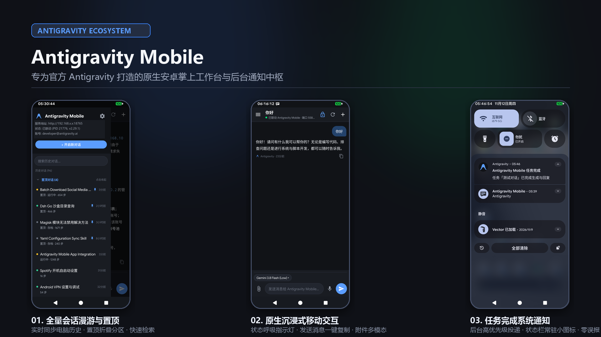
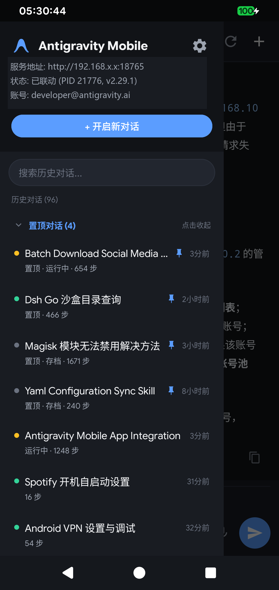
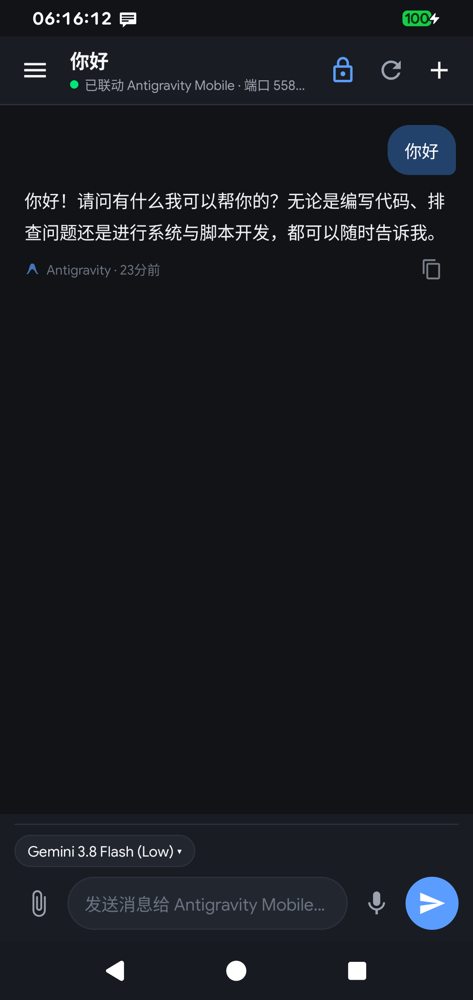
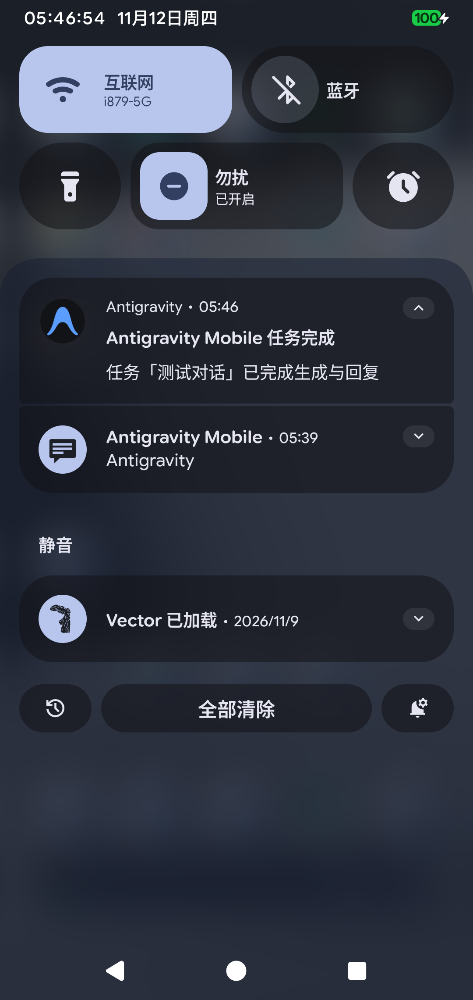
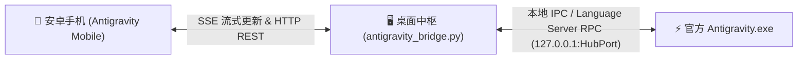

<div align="center">



# Antigravity Mobile 🚀

**专为官方 Google Antigravity 设计的原生安卓掌上工作台与全功能桌面联动中枢**

[](#)
[](#)
[](#)
[](#)

[功能特性](#-核心特性) • [极速上手](#-快速开始) • [多端互联架构](#-技术架构) • [常见问题](#-常见问题)

</div>

---

## 🌟 为什么需要 Antigravity Mobile？

官方桌面版 **Antigravity** 具备强大的代码生成、智能体编排与工程辅助能力，但长久以来缺乏便携的移动交互通道。

当你离开电脑桌、躺在沙发、通勤途中，或在手机上查阅资料时，**Antigravity Mobile** 让你通过安卓手机实现：
- **随时随地下发任务**：手机即刻提问或调度任务，电脑端 Antigravity 自动同步并行执行；
- **全历史无缝漫游**：电脑端的所有历史对话、置顶会话全量实时同步至手机；
- **后台完成通知**：任务在后台跑完或生成完毕后，手机顶部状态栏自动弹出小图标通知，绝不错过任何结果；
- **零额外依赖开箱即用**：桌面端 Bridge 仅使用 Python 原生内置标准库，无需任何 `pip install` 编译或三方服务中转。

---

## 📱 界面预览

| 01. 会话抽屉与置顶管理 | 02. 原生聊天与交互 | 03. 任务完成系统通知 |
| :---: | :---: | :---: |
|  |  |  |
| **实时同步历史 · 置顶折叠 · 搜索** | **呼吸指示灯 · 一键复制 · 附件多模态** | **顶部状态栏常驻 · 零误报 · 点击跳转** |

---

## ✨ 核心特性

- 🔄 **双向实时流式漫游（SSE + RPC）**：采用高效 Server-Sent Events 流式协议，电脑端生成进度与终端输出毫秒级推送到手机端，支持随时手动停止（Stop）。
- 📌 **置顶会话与折叠区分隔**：电脑端置顶的会话在手机抽屉顶部独立聚合折叠展示，并提供清晰的分隔线与常规对话区，管理井井有条。
- 🟢 **多状态智能呼吸指示灯**：
  - `亮绿闪烁 (Fluorescent Pulse)`：Antigravity 正在推理或执行工具；
  - `常亮绿灯 (Solid Green)`：电脑端已就绪连接，处于空闲待命状态；
  - `常亮蓝灯 (Solid Blue)`：当前任务已完成回复；
  - `常亮红灯 (Error Red)`：网络断开或电脑端 Antigravity 未启动。
- 📋 **便捷气泡点击与一键复制**：点击自己发送的消息气泡即可展开复制操作条，一键复制已发 Prompt 到剪贴板。
- 🔔 **稳定系统状态栏通知**：基于 Android 13+ 通知通道架构，离开 App 或锁屏后，任务完成时自动在系统顶部状态栏投递通知，点击即刻回跳并查看。
- 🎙️ **多模态多文件交互**：支持从手机选择图片、视频及录制语音直传电脑工作区，大图点击支持全屏手势缩放浏览。
- 🛡️ **轻量级、去敏、零第三方 Python 依赖**：仅需 Python 3.10+ 标准库即可运行，不占用系统多余端口与内存。

---

## 🚀 快速开始

整个部署只需两步：**电脑端启动 Bridge** + **手机端安装并填入地址**。

### 1. 电脑端部署（Windows）

1. **环境准备**：
   - 安装官方 [Antigravity](https://antigravity.google/) 并正常登录。
   - 安装 [Python 3](https://www.python.org/)（安装时勾选 `Add python.exe to PATH`）。
2. **下载本项目**：
   ```bash
   git clone https://github.com/<your-username>/AntigravityMobile.git
   cd AntigravityMobile
   ```
3. **启动桥接服务**：
   - **方式 A（交互控制台）**：双击运行 `start_bridge.bat`。控制台将自动打印出局域网 IP（例如 `http://192.168.x.x:18765`）。
   - **方式 B（开机静默常驻，推荐）**：双击运行 `install_autostart.bat`，即可一键注册开机后台静默自启。

### 2. 手机端配置（Android）

1. 将项目根目录下的 `AntigravityMobile.apk` 发送到安卓手机并安装；
2. 首次打开 App 时，请在系统弹窗中允许**通知权限**（以便接收任务完成通知）；
3. 打开侧边栏抽屉 ➔ 点击右上角小齿轮 **设置**；
4. 在“服务地址”一栏填入刚才电脑端打印的地址：
   ```text
   http://192.168.x.x:18765
   ```
   > 💡 **远程/外网访问**：若出门在外，可配合 Tailscale / ZeroTier 虚拟内网，或使用 Cloudflare Tunnel / FRP 穿透，将此处地址直接填为穿透域名即可全天候漫游使用。
5. 点击“保存”，App 顶部圆点点亮为绿色，显示 `已联动 Antigravity Mobile`，大功告成！

---

## 🏗️ 技术架构



- **移动前端**：Kotlin 原生开发，Material Design 3 风格，ViewBinding + DiffUtil 高性能 RecyclerView 架构。
- **桌面桥接**：Python 3 原生 `http.server` + `sqlite3` 本地索引快照，非阻塞长连接轮询，自动探测 Antigravity 内部 Hub 端口。

---

## ❓ 常见问题

<details>
<summary><b>Q1: 手机 App 显示“未连接电脑 Bridge”怎么办？</b></summary>

1. 确认电脑端 `start_bridge.bat` 处于运行状态；
2. 确认手机与电脑处于**同一 Wi-Fi / 局域网**（或处于相同的 Tailscale 虚拟网中）；
3. 检查 Windows Defender 防火墙是否拦截了 `18765` 端口，首次运行请勾选“允许局域网通信”。
</details>

<details>
<summary><b>Q2: 任务完成后手机没有收到通知？</b></summary>

1. 请在手机“系统设置 ➔ 应用管理 ➔ Antigravity ➔ 通知管理”中确认通知权限已开启；
2. 若开启了系统“勿扰模式（DND）”，通知可能会被系统收纳至通知抽屉静音展示；
3. 部分手机（如 MIUI / HyperOS / ColorOS）建议开启“自启动”或将省电策略设置为“无限制”，防止系统在锁屏后杀死后台进程。
</details>

<details>
<summary><b>Q3: 换了一台新电脑，需要重新配置吗？</b></summary>

不需要！脚本完全去敏，已自动动态适配任何 Windows 电脑的用户名和应用安装路径，复制到新电脑上双击 `start_bridge.bat` 即可直接使用。
</details>

---

## 📄 开源许可证

本项目基于 [MIT License](LICENSE) 开源。
欢迎提出 Issue 与 Pull Request 共同完善！
